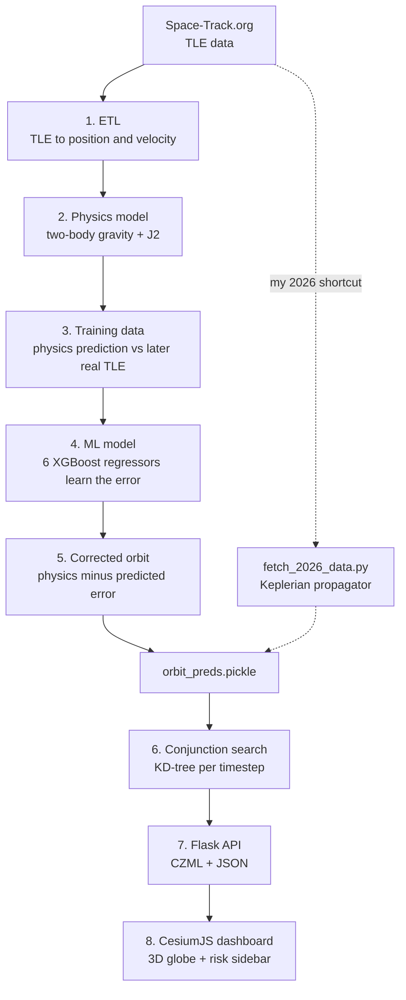

# SSA Conjunction Search Dashboard

**Space Situational Awareness (SSA): predicting orbits and finding close approaches between satellites and debris**

Built by **Prerna** during the **DRDO Research Internship, 2026**, on top of IBM's open-source [`spacetech-ssa`](https://github.com/IBM/spacetech-ssa) pipeline (Apache 2.0).

---

## 1. The problem

More than 27,000 tracked objects (active satellites, dead satellites, rocket bodies and debris) orbit Earth at about 7 km/s. Even small debris can seriously damage a satellite at that speed.

SSA tries to answer one question:

> **Which objects will come dangerously close to each other in the next few days?**

A close approach between two objects is called a **conjunction**. This project predicts orbits, searches for conjunctions, and shows the results on an interactive 3D globe.

---

## 2. What is mine and what is IBM's

| Part | Owner |
|---|---|
| ETL, physics model, ML error model, training data builder (`orbit_prediction/`) | **IBM original.** Studied and documented, not modified. |
| KD-tree conjunction search, CZML builder (`conjunction_search.py`, `czml.py`) | **IBM original** |
| `data_access.py` fix (hardcoded path, removed cloud-only imports) | **Mine** |
| `/details` API route, risk levels, timestep to UTC conversion (`api.py`) | **Mine** |
| Dashboard redesign: `index.html`, `index.css`, `app.js` (sidebar, filters, CSV export, Cesium 1.71 to 1.144) | **Mine** |
| `fetch_2026_data.py`: live Space-Track fetch plus a pure-Python Keplerian propagator | **Mine** |

---

## 3. Pipeline overview



Solid lines are IBM's full pipeline. Dotted lines are the shortcut I built to get fresh 2026 data.

---

## 4. Concepts explained step by step

### 4.1 TLE data
A **TLE (Two-Line Element set)** is the standard text format describing a satellite's orbit. Example (illustrative):

```
ISS (ZARYA)
1 25544U 98067A   26234.00000000  .00002386  00000-0  41420-4 0  9990
2 25544  51.6461 339.8014 0002571  34.5857 120.4689 15.48919393268649
```

- Line 1: satellite number, classification, epoch (time of the data), drag term.
- Line 2: inclination, RAAN, eccentricity, argument of perigee, mean anomaly, mean motion.
- Mean motion 15.49 means the ISS orbits Earth about 15.5 times per day.

### 4.2 IBM's physics model (`physics_model.py`)
- Starts from a known position and velocity (r, v) at one time.
- Predicts forward by numerically solving the equations of motion (Cowell's method, via the `poliastro` library).
- Forces included: Earth's gravity (two-body) plus **J2**, the effect of Earth bulging at the equator.
- Forces **not** included: atmospheric drag, solar radiation pressure, Moon and Sun gravity. These are the main reasons the physics prediction drifts over time.

### 4.3 IBM's ML error correction (`build_training_data.py`, `ml_model.py`)
The idea is **hybrid modeling**: let physics do the main work and let ML learn only what physics gets wrong.

1. Take about 30 days of TLEs per object and group them into 3-day windows.
2. Use the earliest TLE in a window as the starting state and predict later times with the physics model.
3. Compare each prediction with the real later TLE. **Error = physics prediction minus actual.** This is done for all 6 components (r_x, r_y, r_z, v_x, v_y, v_z).
4. Train **6 separate XGBoost regressors**, one per component. Inputs are elapsed seconds, the physics-predicted state and the starting state.
5. At prediction time: **final orbit = physics prediction minus predicted error.**

Why XGBoost: the data is tabular, relationships are non-linear, no feature scaling is needed, it trains fast, and it reports feature importance. Why predict the error instead of the orbit: the correction is small, so it needs less data and is safer than learning orbits from scratch.

### 4.4 Conjunction search (`conjunction_search.py`)
- Predictions are stored as a table: one row per object, one position (or state) per 10-minute timestep.
- For every timestep, a **KD-tree** is built from all objects' positions at that moment.
- To search for a chosen object, its position at each timestep is queried against that timestep's tree, either for the *k* nearest objects or for all objects within a *radius*.
- A KD-tree finds neighbors without comparing against every object, which keeps the search fast.

### 4.5 Flask API (`api.py`)

| Route | Returns |
|---|---|
| `GET /` | HTML page with the object dropdown |
| `GET /conjunction_search/<aso_id>?k=5` or `?radius=100000` | CZML for the 3D globe |
| `GET /conjunction_search/<aso_id>/details` (**mine**) | JSON: name, distance in km, risk level, UTC time |

**Risk levels (my logic, a simple demonstration heuristic):** under 100 km is HIGH, under 500 km is MEDIUM, otherwise LOW. Operational conjunction screening uses much tighter distances and collision probability.

**Timestep to time (mine):** `conjunction_time = pred_start + 10 minutes x timestep`, so the sidebar shows a real UTC time instead of "timestep 46".

### 4.6 CZML and the frontend
**CZML** is a JSON format that CesiumJS reads to animate objects on the globe. Each object lists timestamped x, y, z positions and Cesium interpolates between them.

When the user clicks **Run Search**, `app.js`:
1. Builds two URLs: one for the CZML and one for the details.
2. Shows a loading spinner.
3. Requests both in parallel with `Promise.all`.
4. Draws risk-coloured result cards (red, yellow, green).
5. Applies the debris / active filter (names containing `DEB` or `R/B` count as debris).
6. Offers **CSV export** of the results.

---

## 5. My 2026 data pipeline (`fetch_2026_data.py`)

IBM's ETL depends on `poliastro`, which is no longer maintained, and it failed to install on my Python 3.13 setup. To get fresh data I wrote my own:

1. Log in to Space-Track and request general-perturbation data, filtered to LEO (`mean_motion > 11`, `eccentricity < 0.25`, 50 objects).
2. For each object, run a **pure-Python Keplerian propagator**:
   - semi-major axis from mean motion: `a = (GM / n^2)^(1/3)`
   - solve Kepler's equation `E - e sin(E) = M` with Newton's method
   - compute true anomaly and distance, then rotate from the orbital plane into the ECI frame using RAAN, inclination and argument of perigee
3. Store x, y, z in metres for 432 timesteps (3 days at 10-minute spacing).
4. Save as `orbit_preds.pickle`.

---

## 6. Limitations

- The bundled sample data is IBM's August 2020 data (20 objects, 6-column state vectors). In that file the saved final orbits equal the physics prediction exactly, so the ML correction is stored but not applied.
- My 2026 pickle uses Keplerian propagation only: **no J2, no drag, no ML correction.** It is less accurate than IBM's physics model.
- In the code snapshot I studied, training builds 13 input features while prediction builds 7, so the ML stage would need that mismatch resolved before a full end-to-end run.
- Risk thresholds are illustrative, not operational.
- Object type filtering is name-based.

---

## 7. Run the dashboard locally

```powershell
cd spacetech-ssa-master\conjunction_search
pip install flask flask-restful numpy pandas requests scikit-learn
$env:DEV = "true"
python -m conjunction_search.api
```

Open <http://localhost:8080>, choose an object, set `k` or a radius, and click **Run Search**. An optional `CESIUM_API_KEY` environment variable enables Cesium Ion assets.

Note: `requirements.txt` lists the old package name `sklearn`; install `scikit-learn` instead.

---

## 8. Glossary

| Term | Meaning |
|---|---|
| TLE | Two-Line Element set, the standard orbit data format |
| LEO | Low Earth Orbit, roughly 300 to 2000 km altitude |
| ASO | Anthropogenic Space Object, a man-made object in space |
| Conjunction | Two objects passing dangerously close |
| ECI | Earth-Centered Inertial coordinate frame |
| J2 | Gravity effect from Earth's equatorial bulge |
| Cowell's method | Numerical integration of the equations of motion |
| KD-tree | Spatial index for fast nearest-neighbor search |
| CZML | JSON format that CesiumJS uses for animation |
| XGBoost | Gradient-boosted decision trees for regression |

---

## Credits
Original pipeline: IBM `spacetech-ssa` (Apache 2.0). Dashboard, API extensions and 2026 data pipeline: Prerna.
